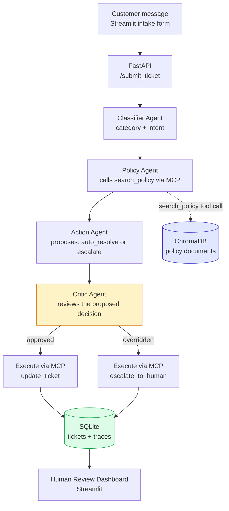

# Sribhava Retail Support Agent

A multi-agent AI system that triages customer support tickets end-to-end: classifying incoming messages, retrieving the relevant company policy, deciding whether to auto-resolve or escalate to a human, and reviewing that decision through a dedicated safety agent before it executes — all backed by a real Model Context Protocol (MCP) server, a persistent SQLite ticketing system, and a full audit trail of every agent's reasoning.

## What it does

A customer submits a message (e.g. "I want a refund of $250 for my damaged item"). The system:

1. **Classifies** the ticket into a category and intent
2. **Retrieves** the relevant company policy from a vector database
3. **Decides** whether the ticket can be safely auto-resolved or must be escalated
4. **Reviews** that decision through a separate Critic agent before it's allowed to execute
5. **Executes** the final action — updating the ticket or escalating it to a human — through a real MCP server
6. **Logs** every agent's decision and reasoning to a permanent trace, and surfaces anything needing human review on a dashboard

## Architecture



The Critic Agent (highlighted) is the safety checkpoint: it can override the Action Agent's proposal, forcing an escalation even when auto-resolution was originally proposed.

## Why this is genuinely agentic, not just RAG

Unlike a fixed retrieve-then-generate pipeline, this system makes real, branching decisions: the Action Agent's choice determines what happens next, the Critic Agent can override that choice entirely, and the system takes a real, verifiable action (a database write via MCP) rather than only generating text. The value of this system doesn't depend on private information an LLM couldn't already know — it depends on taking real actions a raw LLM call cannot perform on its own.

## Tech stack

- **LLM**: Google Gemini (`gemini-3.5-flash-lite`), using native structured function calling
- **Vector database**: ChromaDB, storing company policy documents
- **Embeddings**: `sentence-transformers` (`all-MiniLM-L6-v2`)
- **Agent orchestration**: LangGraph, coordinating the four-agent pipeline as an explicit state graph (migrated from an initial hand-built sequential version, built first to ensure genuine understanding of the underlying mechanics before adopting the framework)
- **Agent-to-tool protocol**: a custom-built MCP server (Python MCP SDK), exposing `search_policy`, `update_ticket`, and `escalate_to_human` as real, callable tools
- **Data store**: SQLite (tickets and a full decision trace log)
- **Backend**: FastAPI
- **Frontend**: Streamlit (a customer-facing intake form and a separate human review dashboard)
- **Evaluation data**: `bitext/Bitext-customer-support-llm-chatbot-training-dataset` (Hugging Face), a real, publicly labeled dataset of 26,872 customer support messages

## The four agents

- **Classifier Agent** — reads the raw message, predicts category and intent using Gemini's native structured function calling (a JSON schema "form" Gemini fills out, rather than parsing free text)
- **Policy Agent** — calls the MCP server's `search_policy` tool (a genuine MCP protocol call over stdio, not a direct function call) to retrieve the relevant policy, then reasons about what it means for this specific ticket
- **Action Agent** — decides `auto_resolve` or `escalate`, with an explicit instruction to escalate rather than guess whenever the message lacks the specific details needed to confidently apply a policy threshold
- **Critic Agent** — a dedicated reflection/safety-review agent that inspects the Action Agent's proposed decision before it executes, specifically checking whether an `auto_resolve` decision is actually justified by the retrieved policy, and overriding it to a forced escalation if not

## Data

- **Realistic ticket text + evaluation labels**: the real, public Bitext dataset — both the messages used to test the system and the ground-truth category/intent labels used to measure accuracy
- **Company policies**: an original, self-authored set of 12 policy documents for a fictional company ("Sribhava Retail"), covering Order Cancellation, Refunds, Account Security, Shipping, Delivery, Payment, Subscriptions, Invoices, Warranty, Complaints/Feedback, Contact Channels, and an Escalation Summary. Genuine internal company policies (specific dollar thresholds, escalation rules) are never publicly available for any real company, so these were deliberately authored, informed by the real category structure of a legitimate academic dataset of published Terms of Service documents, without copying any real company's actual wording
- **Tickets and traces**: generated entirely by the system itself as it runs, starting empty

## Real bugs found and fixed during development

- **Missing context passed to the Policy Agent**: the Policy Agent initially received only the Classifier's category/intent labels, not the original message — meaning specific details (a dollar amount, a stated reason) present in the customer's actual message were invisible to the Policy Agent's reasoning, even though they were genuinely available. Fixed by passing the original message through explicitly.
- **An undefined threshold in the Refunds policy**: the original policy only specified rules for refunds under $50 and over $300, leaving the $50–$300 range undefined. This was discovered when the Critic Agent's reasoning revealed it was inferring a plausible-but-unstated rule for that range. Fixed by explicitly defining all three bands.
- **stdout contamination in the MCP server**: a debug `print()` statement inside the MCP server was writing directly to stdout — the same channel used for the actual MCP protocol communication — causing a JSON parsing error in the calling agent. Fixed by redirecting diagnostic output to stderr.
- **Missing classification data on the dashboard**: the Classifier Agent's real, correctly-computed category and intent were being logged to the trace table but never written back onto the ticket record itself, causing the dashboard to display "None / None" for otherwise-correct tickets. Fixed by adding an explicit update to the ticket row alongside the trace log entry.
- **Redundant MCP server spawning**: the Policy Agent and Action Agent's execution step each independently started their own MCP server subprocess and connection, meaning every ticket spawned two separate server processes rather than sharing one. Discovered by tracing exactly where the server startup code lived across files. Fixed as part of the LangGraph migration, where a single MCP session is opened once per pipeline run and shared across every node via closure.

## Evaluation

Evaluated against 20 randomly sampled real tickets from the Bitext dataset, comparing the Classifier Agent's predictions against the dataset's real, human-labeled ground truth.

**Category accuracy: 85%** (after adding explicit disambiguation guidance for commonly-confused category pairs, e.g. distinguishing cancellation-fee questions (`CANCEL`) from general subscription management (`SUBSCRIPTION`))

**Intent evaluation methodology finding**: initial evaluation using exact-string-match against Bitext's specific intent naming convention showed only 10% accuracy. Manual review revealed most of these were not genuine errors — the Classifier was reasoning correctly but phrasing intents differently than Bitext's internal convention (e.g. predicting `speak_to_agent` where the dataset's label was `contact_human_agent`). Re-evaluating using semantic similarity (cosine similarity between embedded intent labels, threshold ≥ 0.7) raised measured accuracy to 45%, with an average similarity of 0.639 — a more honest reflection of actual performance than exact-match alone, though still revealing that the underlying embedding model has real limitations when comparing short, terse technical labels rather than full sentences.

**A genuine, documented side effect**: adding disambiguation guidance to fix the CANCEL/SUBSCRIPTION confusion improved that specific case, but introduced a new, different confusion (ACCOUNT vs. SUBSCRIPTION for "switch account type" questions) — a real, honest example of a targeted fix shifting rather than eliminating an error pattern.

## Known limitations

- Intent-level accuracy remains meaningfully lower than category-level accuracy, even after correcting for evaluation methodology — a real, unresolved limitation given the current 20-ticket sample size and prompt design
- The Critic Agent's review criteria are prompt-based, not independently verified against a separate labeled "should this have been escalated" dataset
- Company policies are self-authored and fictional, not sourced from a real company's actual internal rules
- Evaluated on a 20-ticket sample; a larger sample (50-100 tickets) would give a more statistically robust accuracy figure
- **Cloud deployment (AWS EC2) was scoped and researched in detail but deliberately not pursued.** The system is fully built, tested, and confirmed working via Docker, run identically on any machine with Docker installed. Given AWS requires a credit card even for free-tier usage, and given a genuine, reasoned preference to avoid any financial risk while between jobs, deployment was consciously deprioritized rather than pursued reflexively. The Docker image is deployment-ready; this remains a deliberate, not accidental, scope decision.

## Setup

```bash
# Install dependencies
pip install -r requirements.txt

# Set your Gemini API key
echo "GEMINI_API_KEY=your_key_here" > .env

# Build the policy knowledge base (run once)
python build_embeddings.py
python build_vectordb.py

# Initialize the databases (run once)
python build_ticket_db.py
python build_traces_db.py

# Run the API
uvicorn api:app --reload

# In a separate terminal, run the customer intake form
streamlit run submit_ticket.py

# In a separate terminal, run the human review dashboard
streamlit run dashboard.py
```

## Project structure

```
├── sribhava_policies.md    # Original policy documents (12 sections)
├── build_embeddings.py     # Embeds policy chunks
├── build_vectordb.py       # Loads embeddings into ChromaDB
├── build_ticket_db.py      # Initializes the tickets table
├── build_traces_db.py      # Initializes the traces table
├── mcp_server.py           # MCP server: search_policy, update_ticket, escalate_to_human
├── trace_logger.py         # create_ticket, log_trace shared helpers
├── classifier_agent.py     # Classifier Agent
├── policy_agent.py         # Policy Agent
├── action_agent.py         # Action Agent (decide_action, execute_decision)
├── critic_agent.py         # Critic Agent
├── langgraph_pipeline.py   # Connects all four agents via a LangGraph StateGraph
├── api.py                  # FastAPI backend
├── submit_ticket.py        # Customer-facing intake form (Streamlit)
├── dashboard.py             # Human review dashboard (Streamlit)
├── build_eval_set.py       # Samples real Bitext tickets for evaluation
├── run_evaluation.py       # Runs evaluation, computes accuracy metrics
├── Dockerfile               # Containerizes the FastAPI backend + MCP server
├── requirements.txt         # Python dependencies, including langgraph
```
