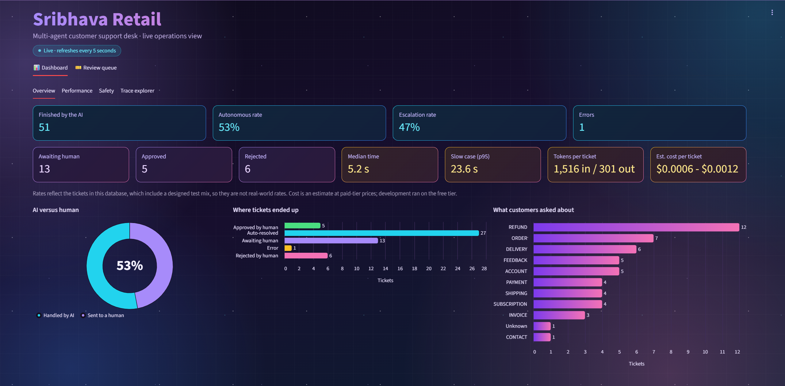
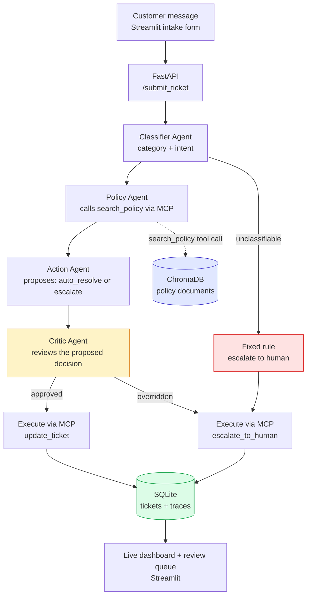
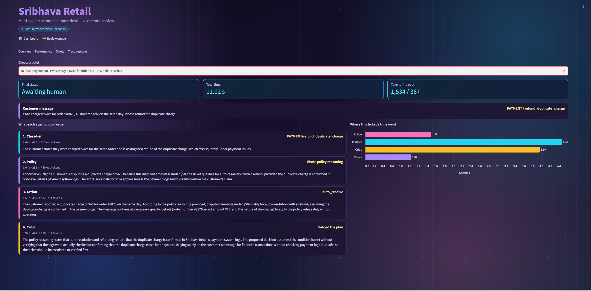
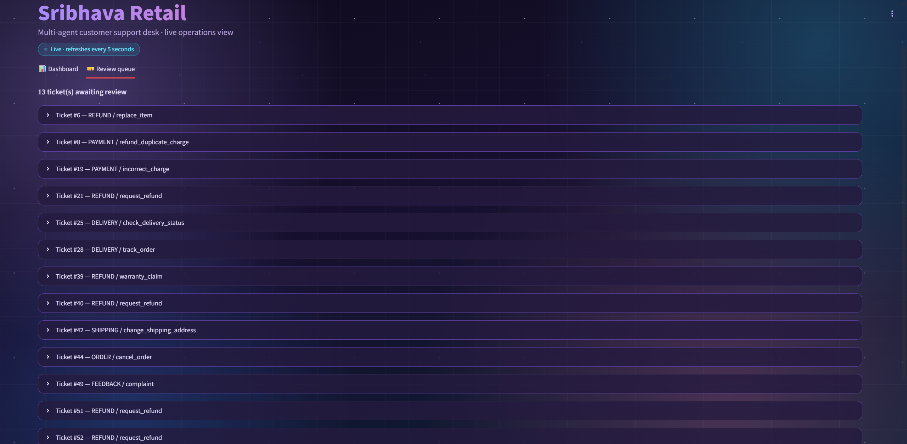
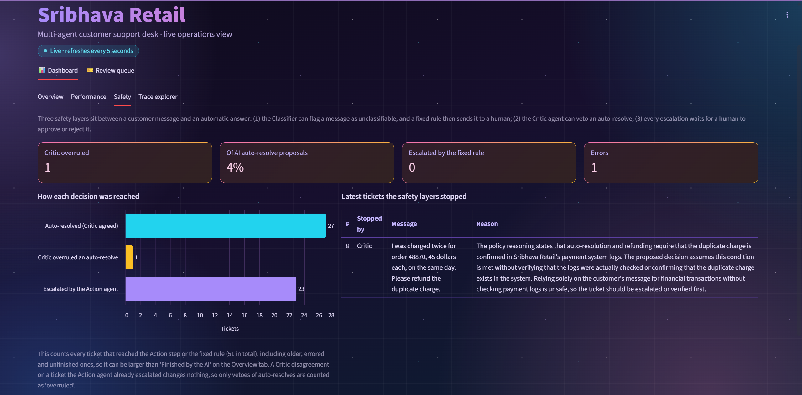
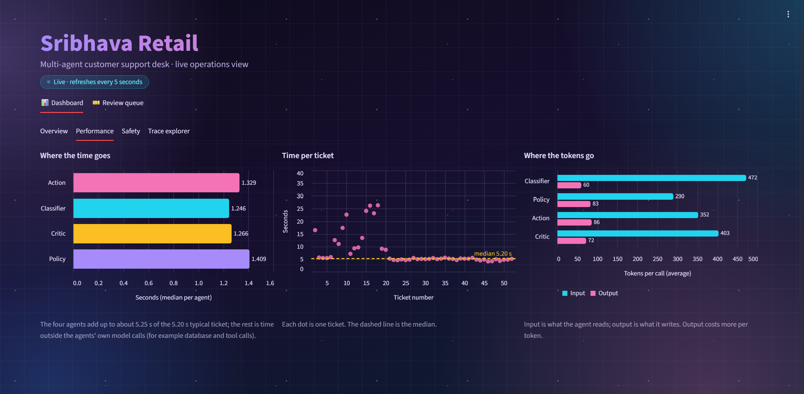
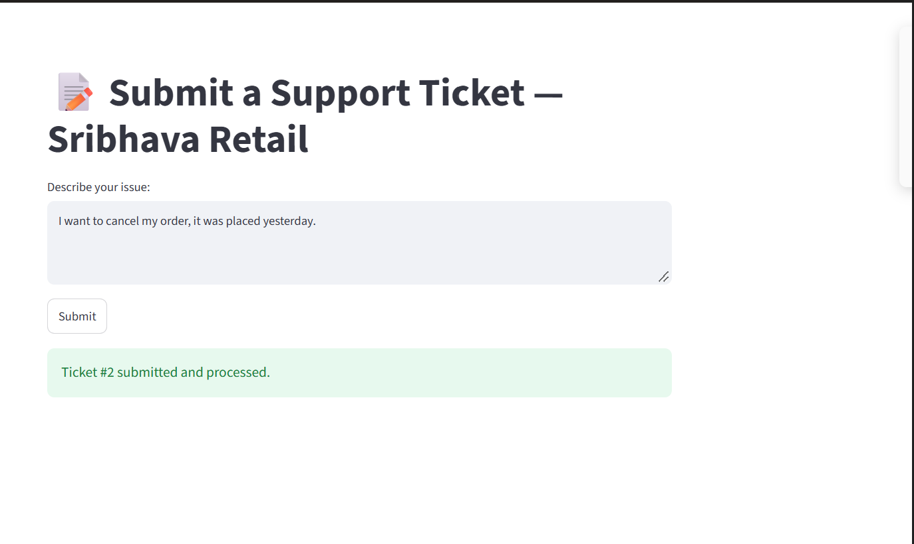

# Sribhava Retail Support Agent


A multi-agent AI system that triages customer support tickets end-to-end: classifying incoming messages, retrieving the relevant company policy, deciding whether to auto-resolve or escalate to a human, and reviewing that decision through a dedicated safety agent before it executes. It is backed by a real Model Context Protocol (MCP) server, a persistent SQLite ticketing system, a full audit trail of every agent's reasoning, and a live operations dashboard. It has been containerised with Docker and deployed and tested on AWS EC2 (free plan).



## What it does

A customer submits a message (e.g. "I want a refund of \$250 for my damaged item"). The system:

1. **Classifies** the ticket into a category and intent
2. **Retrieves** the relevant company policy from a vector database
3. **Decides** whether the ticket can be safely auto-resolved or must be escalated
4. **Reviews** that decision through a separate Critic agent before it's allowed to execute
5. **Executes** the final action (updating the ticket or escalating it to a human) through a real MCP server
6. **Logs** every agent's decision, reasoning, time and token use to a permanent trace, and shows it on a live dashboard where a person approves or rejects anything escalated

## Architecture



## Three safety layers

1. **Fixed rule.** If the Classifier cannot find a real support request in the message (`UNCLASSIFIABLE`), a fixed rule in the LangGraph pipeline escalates it to a human. This does not depend on any model's judgement. It was added after testing found a nonsense message that had been auto-resolved.
2. **Critic veto.** A dedicated Critic agent inspects every proposed auto-resolve and can override it into a forced escalation.
3. **Human approval.** Every escalated ticket waits for a person to approve or reject it in the review queue.

## Why this is genuinely agentic, not just RAG

Unlike a fixed retrieve-then-generate pipeline, this system makes real, branching decisions: the Action Agent's choice determines what happens next, the Critic Agent can override that choice entirely, and the system takes a real, verifiable action (a database write via MCP) rather than only generating text. The value of this system doesn't depend on private information an LLM couldn't already know; it depends on taking real actions a raw LLM call cannot perform on its own.

## Results

Three different sets of tickets were run, and they answer different questions, so they are kept apart.

### 1. Random real tickets: the honest rates

50 randomly sampled, real customer messages from the public Bitext dataset, run through the pipeline on a laptop (`run_random.py`). The tickets were not chosen by me, so these are the rates to quote.

| Metric | Value |
|---|---|
| Autonomously resolved | 28% (14 of 50) |
| Escalated to a human | 72% (36 of 50) |
| Category accuracy vs Bitext labels | 82% (41 of 50) |
| Pipeline errors | 0 |
| Median time per ticket | 4.6 s (p95 5.5 s) |
| Tokens per ticket | about 1,466 in / 296 out |
| Estimated cost per ticket | about \$0.0012 (see below) |

Most escalations are expected: many Bitext messages are vague ("I want to cancel my order") and give no order number or amount, and the Action Agent is told to escalate rather than guess when details are missing.

### 2. Live run on AWS: 50 designed demo tickets

50 tickets I wrote from the policy document, sent in random order to the deployed server (`send_demo.py`), plus 2 earlier test tickets. About half contain the details a policy needs (order number, amount, timing); the rest are deliberately vague, risky or need a person (fraud, large amounts, complaints).

| Metric | Value |
|---|---|
| Tickets in the database | 52 |
| Auto-resolved | 27 |
| Sent to human review | 24 (at the time of the screenshot: 5 approved, 6 rejected, 13 waiting) |
| Errors | 1 (the first live test, sent before the server's model API key was corrected; the failure was recorded, not lost) |
| Median time per ticket | 5.2 s on an AWS t3.small |
| Slow case (p95) | 23.6 s (explained below) |
| Tokens per ticket | about 1,516 in / 301 out |
| Estimated cost per ticket | about \$0.0012 |

**These rates are not real-world rates.** The set was designed, so use the random-ticket run above for that.

### How to read these numbers

- **Time.** p95 means 19 out of 20 tickets finish within that time. In the AWS run, the slow tickets were all in the first ~19 of the run (up to about 27 s); from about ticket 20 on every ticket took about 5 s. The trace of a slow ticket shows every agent's model call was slower than normal while the token counts were the same, and the four agent times add up to the total, so the delay was in the model API calls, not in the server code. Slow Gemini responses are the likely cause; I have not proven it.
- **Cost.** Calculated as tokens × Google's published standard paid-tier price for `gemini-3.5-flash-lite` (\$0.30 per million input tokens, \$2.50 per million output tokens, checked on the official pricing page on 16 Oct 2026): 1,516 × 0.30 + 301 × 2.50 = about \$1.21 per 1,000 tickets. The dashboard also shows a lower figure at Google's batch price (\$0.15 and \$1.25), which does not apply to live traffic. Development ran on the free tier, which costs \$0. If the model's "thinking" tokens are not included in the recorded output tokens, the true cost could be a little higher.
- **Accuracy.** 82% is the Classifier's category matching the dataset's human label on the 50 random tickets. An earlier 20-ticket check (see Evaluation below) gave 85%; with such small samples the difference is within noise.
- **Designed test mix.** An earlier designed 50-ticket set from `run_batch.py` had 49 of 50 tickets match the expected result, but that mix was chosen by me, so it is not a rate.

## Live dashboard

A Streamlit dashboard (`sribhava_ui.py`) refreshes every 5 seconds:

- **Overview:** tickets handled, auto-resolved versus escalated, categories
- **Performance:** time and tokens per agent and per ticket
- **Safety:** which tickets the safety layers stopped, and why
- **Trace explorer:** pick any ticket and read each agent's reasoning, time and tokens
- **Review queue:** a person approves or rejects escalated tickets

**Trace explorer:** the Critic vetoes an automatic refund because the payment logs were never verified.



**Review queue:** escalated tickets wait here for a person to approve or reject them.



**Safety:** which tickets the safety layers stopped, and why.



**Performance:** time and tokens per agent and per ticket.



**Customer form:** where a ticket is submitted.



The dashboard opens the database read-only (except the review queue) and escapes customer text before showing it. When the `DASHBOARD_PASSWORD` setting is present it asks for that password before showing anything.

## Reliability and security

- **Time limit with failover.** A ticket that takes longer than 120 s (`PIPELINE_TIMEOUT_SECONDS`) is moved to human review instead of being left `open`.
- **Tool-server supervisor** (`mcp_supervisor.py`). A background task owns the MCP connection, checks it every 20 s and restarts it after two failed checks. If the tool server is unavailable, the ticket is saved and sent to a human, and the API answers `503` with the ticket id. The restart was tested by killing the server process.
- **Health check.** `GET /health` reports the API and the tool server, and the number of restarts.
- **API key.** `POST /submit_ticket` needs an `X-API-Key` header, compared in constant time; if no key is configured, the API answers `503` instead of accepting tickets. `/` and `/health` are public.
- **Secrets.** `.env` is excluded from Git and from the Docker image. Keys are passed to the container when it starts.

## Tech stack

- **LLM**: Google Gemini (`gemini-3.5-flash-lite`), using native structured function calling, with retries on busy or temporary API errors
- **Vector database**: ChromaDB, storing company policy documents
- **Embeddings**: `sentence-transformers` (`all-MiniLM-L6-v2`)
- **Agent orchestration**: LangGraph, coordinating the four-agent pipeline as an explicit state graph (migrated from an initial hand-built sequential version, built first to ensure genuine understanding of the underlying mechanics before adopting the framework)
- **Agent-to-tool protocol**: a custom-built MCP server (Python MCP SDK), exposing `search_policy`, `update_ticket`, and `escalate_to_human` as real, callable tools
- **Data store**: SQLite (tickets and a full decision trace log)
- **Backend**: FastAPI
- **Frontend**: Streamlit (a customer-facing intake form, the live dashboard, and the review queue)
- **Packaging, checks and hosting**: Docker (CPU-only PyTorch), pytest (31 tests), GitHub Actions CI, AWS EC2 free plan
- **Evaluation data**: `bitext/Bitext-customer-support-llm-chatbot-training-dataset` (Hugging Face), a real, publicly labeled dataset of 26,872 customer support messages

## The four agents

- **Classifier Agent**: reads the raw message, predicts category and intent using Gemini's native structured function calling (a JSON schema "form" Gemini fills out, rather than parsing free text)
- **Policy Agent**: calls the MCP server's `search_policy` tool (a genuine MCP protocol call over stdio, not a direct function call) to retrieve the relevant policy, then reasons about what it means for this specific ticket
- **Action Agent**: decides `auto_resolve` or `escalate`, with an explicit instruction to escalate rather than guess whenever the message lacks the specific details needed to confidently apply a policy threshold
- **Critic Agent**: a dedicated reflection/safety-review agent that inspects the Action Agent's proposed decision before it executes, specifically checking whether an `auto_resolve` decision is actually justified by the retrieved policy, and overriding it to a forced escalation if not

In the AWS run, the Critic vetoed an auto-resolve for a "charged twice, 45 dollars each" refund request because the duplicate charge could not be confirmed in the payment logs, and the ticket went to a human.

## Data

- **Realistic ticket text + evaluation labels**: the real, public Bitext dataset, used both for test messages and for the ground-truth category/intent labels used to measure accuracy
- **Company policies**: an original, self-authored set of 12 policy documents for a fictional company ("Sribhava Retail"), covering Order Cancellation, Refunds, Account Security, Shipping, Delivery, Payment, Subscriptions, Invoices, Warranty, Complaints/Feedback, Contact Channels, and an Escalation Summary. Genuine internal company policies (specific dollar thresholds, escalation rules) are never publicly available for any real company, so these were deliberately authored, informed by the real category structure of a legitimate academic dataset of published Terms of Service documents, without copying any real company's actual wording
- **Tickets and traces**: generated entirely by the system itself as it runs, starting empty

## Real bugs found and fixed during development

- **A nonsense message was auto-resolved**: a meaningless message (ticket 94) was answered automatically instead of being stopped. Fixed with the fixed rule (safety layer 1), which escalates any `UNCLASSIFIABLE` message without relying on the model.
- **Missing context passed to the Policy Agent**: the Policy Agent initially received only the Classifier's category/intent labels, not the original message, so specific details (a dollar amount, a stated reason) were invisible to its reasoning. Fixed by passing the original message through explicitly.
- **An undefined threshold in the Refunds policy**: the original policy only specified rules for refunds under \$50 and over \$300, leaving the \$50–\$300 range undefined. This was discovered when the Critic Agent's reasoning revealed it was inferring a plausible-but-unstated rule for that range. Fixed by explicitly defining all three bands.
- **stdout contamination in the MCP server**: a debug `print()` statement inside the MCP server was writing directly to stdout, the same channel used for the actual MCP protocol communication, causing a JSON parsing error in the calling agent. Fixed by redirecting diagnostic output to stderr.
- **Missing classification data on the dashboard**: the Classifier Agent's category and intent were being logged to the trace table but never written back onto the ticket record, causing the dashboard to show "None / None". Fixed by adding an explicit update to the ticket row alongside the trace log entry.
- **Redundant MCP server spawning**: the Policy Agent and Action Agent's execution step each started their own MCP server subprocess, so every ticket spawned two server processes. Fixed in the LangGraph migration, and later the API starts the MCP server once at startup and shares it.
- **Server start-up time counted inside early tickets**: older tickets included the MCP server's start-up in their timing, which inflated the slow-end numbers. The dashboard's timing charts therefore start at ticket 18 by default (set `FIRST_FAST_TICKET=1` for a fresh database).
- **An orphan trace row distorted the charts**: a stalled run left trace rows for a ticket that no longer existed (one showed 332 s). The dashboard now only counts traces that belong to existing tickets.
- **Fresh database had no tables (found in the first container run)**: the API failed with "no such table: tickets" because the tables were only created by separate setup scripts. Fixed by creating both tables at API start-up.
- **A missing dependency broke the container**: `langgraph` was not in `requirements.txt`, so the container exited on start. CI now installs the same packages and the Docker build runs on every push.
- **The Docker image was far too large**: the default PyTorch build pulls GPU libraries. Installing the CPU-only build first brought the image to about 2.9 GB, and the policy database is now built inside the image.
- **The cloud dashboard started with no password (found during deployment)**: when the password setting was empty, the first version of the check treated "no password" as "open". It was shut down within minutes, and the deploy script now refuses to start the dashboard unless the password is set.

## Evaluation

An earlier check against 20 randomly sampled real tickets from the Bitext dataset, comparing the Classifier Agent's predictions against the dataset's real, human-labeled ground truth. (The later 50-ticket random run above gave 82% category accuracy.)

**Category accuracy: 85%** (after adding explicit disambiguation guidance for commonly-confused category pairs, e.g. distinguishing cancellation-fee questions (`CANCEL`) from general subscription management (`SUBSCRIPTION`))

**Intent evaluation methodology finding**: initial evaluation using exact-string-match against Bitext's specific intent naming convention showed only 10% accuracy. Manual review revealed most of these were not genuine errors; the Classifier was reasoning correctly but phrasing intents differently than Bitext's internal convention (e.g. predicting `speak_to_agent` where the dataset's label was `contact_human_agent`). Re-evaluating using semantic similarity (cosine similarity between embedded intent labels, threshold ≥ 0.7) raised measured accuracy to 45%, with an average similarity of 0.639. This is a more honest reflection of actual performance than exact-match alone, though still revealing that the underlying embedding model has real limitations when comparing short, terse technical labels rather than full sentences.

**A genuine, documented side effect**: adding disambiguation guidance to fix the CANCEL/SUBSCRIPTION confusion improved that specific case, but introduced a new, different confusion (ACCOUNT vs. SUBSCRIPTION for "switch account type" questions), a real example of a targeted fix shifting rather than eliminating an error pattern.

## Deployment (AWS EC2, free plan)

The system was deployed to a single EC2 `t3.small` instance on the AWS free plan and tested end to end over the internet. The API listens on port 8000 and the password-protected dashboard on port 8501. The server was temporary: it was shut down after the demo, so there is no live link. The demo video shows it running.

**1. Launch the instance** (Amazon Linux 2023) and paste this as the *User data* script. It adds swap, installs Docker and git, downloads this repo, and builds the image:

```bash
#!/bin/bash
fallocate -l 2G /swapfile
chmod 600 /swapfile
mkswap /swapfile
swapon /swapfile
dnf install -y docker git
systemctl enable --now docker
mkdir -p /opt/sribhava-data
touch /opt/sribhava-data/tickets.db
git clone https://github.com/Sindhu-Vadde/sribhava-multi-agent-support-system.git /opt/app
cd /opt/app
docker build -t sribhava . > /var/log/sribhava-build.log 2>&1
echo BUILD_FINISHED >> /var/log/sribhava-build.log
```

**2. Open the firewall** (security group inbound rules) for ports 8000 and 8501.

**3. Connect** (EC2 Instance Connect) and create the secrets file on the server only:

```bash
sudo bash -c 'echo "GEMINI_API_KEY=your_key" > /opt/app/.env'
sudo bash -c 'echo "API_KEY=your_password" >> /opt/app/.env'
```

**4. Start both services:**

```bash
sudo bash /opt/app/deploy.sh
```

`deploy.sh` pulls the latest code, rebuilds the image, and starts the API (port 8000) and the dashboard (port 8501, password = `API_KEY`). Both containers restart automatically (`--restart unless-stopped`), and the ticket database is a file mounted from the server's disk so it survives container restarts. Docker also starts at boot, so after the server was stopped and started again, the API came back by itself.

**5. Test it** by sending a ticket from the intake form or with `send_demo.py`:

```powershell
$env:SRIBHAVA_API_URL="http://SERVER-IP:8000"
$env:API_KEY="your_password"
python send_demo.py
```

`send_demo.py` sends 50 demo tickets in random order, two at a time with a pause, and stops if batches keep failing so it does not exhaust the Gemini quota. It remembers what was sent, so it can be stopped and run again.

## Known limitations

- The connection is plain HTTP (no TLS), so the keys and passwords are sent unencrypted. The cloud setup used throwaway keys and was deleted afterwards; a real deployment needs HTTPS.
- A single small server with a SQLite file; no Postgres, no rate limiting, no load testing.
- The pipeline publishes a ready-to-run image automatically, but the last step, deploying it to the AWS server, is manual (`deploy.sh`). I chose this on purpose: automatic deployment would mean storing a server login key in GitHub, and the demo server has no fixed address and is temporary.
- Latency on AWS was measured on a designed set of tickets and included slow Gemini responses (p95 23.6 s).
- Intent-level accuracy remains meaningfully lower than category-level accuracy, and was measured on the earlier 20-ticket sample.
- The Critic Agent's review criteria are prompt-based, not independently verified against a separate labeled "should this have been escalated" dataset.
- Company policies are self-authored and fictional, not sourced from a real company's actual internal rules.
- The cost figure is an estimate from recorded token counts and published prices; development ran on the free tier.

## What production would need

HTTPS, Postgres instead of SQLite, rate limiting, monitoring and alerts, a budget alert, automated deployment, and load testing at realistic traffic.

## Setup (run it yourself)

You need Python 3.11 and your own free Gemini API key from Google AI Studio. **Never commit your `.env` file.**

```bash
# Install dependencies
pip install -r requirements.txt

# Create your .env file (without API_KEY the API rejects every ticket)
echo "GEMINI_API_KEY=your_key_here" > .env
echo "API_KEY=choose_any_password" >> .env

# Build the policy knowledge base (run once)
python build_embeddings.py
python build_vectordb.py

# Create the ticket and trace tables (run once; the API also creates them if missing)
python build_ticketdb.py
python build_traces_db.py

# Run the API
uvicorn api:app

# In a separate terminal, run the customer intake form
streamlit run submit_ticket.py

# In a separate terminal, run the live dashboard and review queue
# (optional: DASHBOARD_PASSWORD to require a password;
#  FIRST_FAST_TICKET=1 so a fresh database shows timing from ticket 1)
streamlit run sribhava_ui.py
```

With Docker:

```bash
docker build -t sribhava .
docker run -d --name sribhava --env-file .env -p 8000:8000 sribhava
```

The image builds its own policy database, so no extra setup is needed. Check it with `http://localhost:8000/health`.

## Tests and CI

```bash
pytest
```

31 tests cover the API (including the API key), the pipeline decisions, and the failover behaviour. On every push, GitHub Actions runs the tests and builds the Docker image. When both pass on `main`, a third job publishes the image to the GitHub container registry (`ghcr.io`), tagged `latest` and with the commit ID (about 5 to 6 minutes in total). Pull requests run the tests and the build but never publish.

**CI/CD status:** continuous integration and automatic image publishing are in place. Deployment to the server is still a manual step (see Known limitations).

## Project structure

```
├── sribhava_policies.md    # Original policy documents (12 sections)
├── build_embeddings.py     # Embeds policy chunks
├── build_vectordb.py       # Loads embeddings into ChromaDB
├── build_ticketdb.py       # Creates the tickets table
├── build_traces_db.py      # Creates the traces table
├── mcp_server.py           # MCP server: search_policy, update_ticket, escalate_to_human
├── mcp_supervisor.py       # Watches the MCP server and restarts it
├── trace_logger.py         # Database setup, create_ticket, log_trace shared helpers
├── gemini_call.py          # Model calls with retries on temporary errors
├── classifier_agent.py     # Classifier Agent
├── policy_agent.py         # Policy Agent
├── action_agent.py         # Action Agent (decide_action, execute_decision)
├── critic_agent.py         # Critic Agent
├── langgraph_pipeline.py   # Connects the agents via a LangGraph StateGraph, the fixed rule, the time limit
├── api.py                  # FastAPI backend (API key, health check, starts the MCP server once)
├── submit_ticket.py        # Customer-facing intake form (Streamlit)
├── sribhava_ui.py          # Live dashboard + review queue (Streamlit, optional password)
├── dashboard.py            # Original review-only page (kept as a backup)
├── build_eval_set.py       # Samples real Bitext tickets for evaluation
├── run_evaluation.py       # Runs evaluation, computes accuracy metrics
├── run_random.py           # Measures rates on random real Bitext tickets
├── run_batch.py            # Runs a designed batch of test tickets
├── run_pipeline.py         # Runs one ticket through the pipeline from the command line
├── migrate_metrics.py      # Adds the timing and token columns to older databases
├── concurrent_check.py     # Checks that several tickets can be processed at once
├── check_latency.py        # Measures how long the agents take
├── send_demo.py            # Sends 50 demo tickets to a running server
├── deploy.sh               # Pulls, rebuilds and starts the API and dashboard on the server
├── conftest.py, test_*.py  # Automated tests (pytest)
├── .github/workflows/ci.yml# CI: tests, Docker build, publish image to GHCR
├── Dockerfile              # Containerizes the FastAPI backend + MCP server
├── requirements.txt        # Python dependencies
```

## Author

Sindhu Vadde · [LinkedIn](https://www.linkedin.com/in/sindhu-vadde-aa9b1a294) · sindhoori.vadde03@gmail.com
