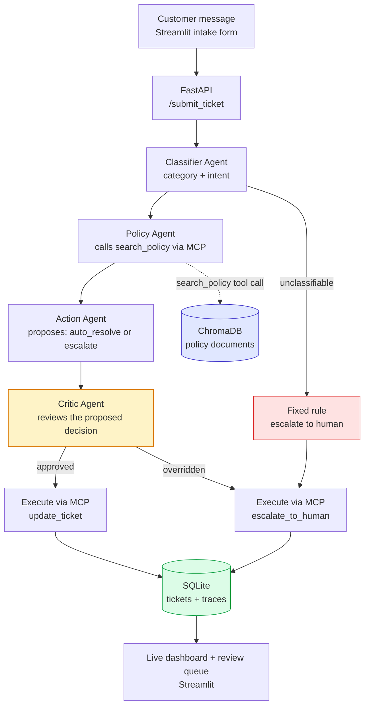

# Sribhava Retail Support Agent

A multi-agent AI system that triages customer support tickets end-to-end: classifying incoming messages, retrieving the relevant company policy, deciding whether to auto-resolve or escalate to a human, and reviewing that decision through a dedicated safety agent before it executes. It is backed by a real Model Context Protocol (MCP) server, a persistent SQLite ticketing system, a full audit trail of every agent's reasoning, and a live operations dashboard.

> **Demo video:** [add link]  ·  **Slides:** [add link]

## What it does

A customer submits a message (e.g. "I want a refund of $250 for my damaged item"). The system:

1. **Classifies** the ticket into a category and intent
2. **Retrieves** the relevant company policy from a vector database
3. **Decides** whether the ticket can be safely auto-resolved or must be escalated
4. **Reviews** that decision through a separate Critic agent before it's allowed to execute
5. **Executes** the final action (updating the ticket or escalating it to a human) through a real MCP server
6. **Logs** every agent's decision, reasoning, time and token use to a permanent trace, and shows it on a live dashboard where a person approves or rejects anything escalated

## Architecture



## Three safety layers

1. **Fixed rule.** If the Classifier cannot find a real support request in the message (`UNCLASSIFIABLE`), a fixed rule in the LangGraph pipeline escalates it to a human. This does not depend on any model's judgement. It was added after testing found a nonsense message that had been auto-resolved.
2. **Critic veto.** A dedicated Critic agent inspects every proposed auto-resolve and can override it into a forced escalation.
3. **Human approval.** Every escalated ticket waits for a person to approve or reject it in the review queue.

## Why this is genuinely agentic, not just RAG

Unlike a fixed retrieve-then-generate pipeline, this system makes real, branching decisions: the Action Agent's choice determines what happens next, the Critic Agent can override that choice entirely, and the system takes a real, verifiable action (a database write via MCP) rather than only generating text. The value of this system doesn't depend on private information an LLM couldn't already know; it depends on taking real actions a raw LLM call cannot perform on its own.

## Results

Measured on tickets in the development database (ticket 18 onward, after timing was recorded correctly):

| Metric | Value |
|---|---|
| Median time per ticket | 5.5 s |
| Slow case (p95) | 7.8 s |
| Tokens per ticket | about 1,287 in / 269 out |
| Estimated cost per ticket | $0.0005 to $0.0011 |
| Policy outcome on a designed 50-ticket test set | 49 of 50 matched the expected result |

**How to read these numbers**

- p95 means 19 out of 20 tickets finish within that time. Ticket 59 is the slowest example (about 13 s), caused by a slow model API response.
- Cost is an **estimate** from token counts and published paid-tier prices (two price sources disagree, hence the range). Development ran on the free tier, which costs $0. Check current prices at <https://ai.google.dev/pricing>.
- The 50-ticket set was **designed** to mix easy and risky tickets. The autonomous (57%) and escalation (43%) rates shown on the dashboard come from this mix, so **they are not real-world rates**. A run on randomly generated tickets is planned.
- Some tickets in the development database are in an error state: [add one line explaining the cause once checked].

## Live dashboard

A Streamlit dashboard (`sribhava_ui.py`) refreshes every 5 seconds:

- **Overview:** tickets handled, auto-resolved versus escalated, categories
- **Performance:** time and tokens per agent and per ticket
- **Safety:** which tickets the safety layers stopped, and why
- **Trace explorer:** pick any ticket and read each agent's reasoning, time and tokens
- **Review queue:** a person approves or rejects escalated tickets

[add screenshots: overview, performance, trace explorer, safety]

The dashboard opens the database read-only (except the review queue) and escapes customer text before showing it.

## Tech stack

- **LLM**: Google Gemini (`gemini-3.5-flash-lite`), using native structured function calling, with retries on busy or temporary API errors
- **Vector database**: ChromaDB, storing company policy documents
- **Embeddings**: `sentence-transformers` (`all-MiniLM-L6-v2`)
- **Agent orchestration**: LangGraph, coordinating the four-agent pipeline as an explicit state graph (migrated from an initial hand-built sequential version, built first to ensure genuine understanding of the underlying mechanics before adopting the framework)
- **Agent-to-tool protocol**: a custom-built MCP server (Python MCP SDK), exposing `search_policy`, `update_ticket`, and `escalate_to_human` as real, callable tools
- **Data store**: SQLite (tickets and a full decision trace log)
- **Backend**: FastAPI
- **Frontend**: Streamlit (a customer-facing intake form, the live dashboard, and the review queue)
- **Packaging and checks**: Docker, pytest, GitHub Actions
- **Evaluation data**: `bitext/Bitext-customer-support-llm-chatbot-training-dataset` (Hugging Face), a real, publicly labeled dataset of 26,872 customer support messages

## The four agents

- **Classifier Agent**: reads the raw message, predicts category and intent using Gemini's native structured function calling (a JSON schema "form" Gemini fills out, rather than parsing free text)
- **Policy Agent**: calls the MCP server's `search_policy` tool (a genuine MCP protocol call over stdio, not a direct function call) to retrieve the relevant policy, then reasons about what it means for this specific ticket
- **Action Agent**: decides `auto_resolve` or `escalate`, with an explicit instruction to escalate rather than guess whenever the message lacks the specific details needed to confidently apply a policy threshold
- **Critic Agent**: a dedicated reflection/safety-review agent that inspects the Action Agent's proposed decision before it executes, specifically checking whether an `auto_resolve` decision is actually justified by the retrieved policy, and overriding it to a forced escalation if not

## Data

- **Realistic ticket text + evaluation labels**: the real, public Bitext dataset, used both for test messages and for the ground-truth category/intent labels used to measure accuracy
- **Company policies**: an original, self-authored set of 12 policy documents for a fictional company ("Sribhava Retail"), covering Order Cancellation, Refunds, Account Security, Shipping, Delivery, Payment, Subscriptions, Invoices, Warranty, Complaints/Feedback, Contact Channels, and an Escalation Summary. Genuine internal company policies (specific dollar thresholds, escalation rules) are never publicly available for any real company, so these were deliberately authored, informed by the real category structure of a legitimate academic dataset of published Terms of Service documents, without copying any real company's actual wording
- **Tickets and traces**: generated entirely by the system itself as it runs, starting empty

## Real bugs found and fixed during development

- **A nonsense message was auto-resolved**: a meaningless message (ticket 94) was answered automatically instead of being stopped. Fixed with the fixed rule (safety layer 1), which escalates any `UNCLASSIFIABLE` message without relying on the model.
- **Missing context passed to the Policy Agent**: the Policy Agent initially received only the Classifier's category/intent labels, not the original message, so specific details (a dollar amount, a stated reason) were invisible to its reasoning. Fixed by passing the original message through explicitly.
- **An undefined threshold in the Refunds policy**: the original policy only specified rules for refunds under $50 and over $300, leaving the $50–$300 range undefined. This was discovered when the Critic Agent's reasoning revealed it was inferring a plausible-but-unstated rule for that range. Fixed by explicitly defining all three bands.
- **stdout contamination in the MCP server**: a debug `print()` statement inside the MCP server was writing directly to stdout, the same channel used for the actual MCP protocol communication, causing a JSON parsing error in the calling agent. Fixed by redirecting diagnostic output to stderr.
- **Missing classification data on the dashboard**: the Classifier Agent's category and intent were being logged to the trace table but never written back onto the ticket record, causing the dashboard to show "None / None". Fixed by adding an explicit update to the ticket row alongside the trace log entry.
- **Redundant MCP server spawning**: the Policy Agent and Action Agent's execution step each started their own MCP server subprocess, so every ticket spawned two server processes. Fixed in the LangGraph migration, and later the API starts the MCP server once at startup and shares it.
- **Server start-up time counted inside early tickets**: older tickets included the MCP server's start-up in their timing, which inflated the slow-end numbers. The dashboard's timing charts therefore start at ticket 18, where timing is recorded correctly.
- **An orphan trace row distorted the charts**: a stalled run left trace rows for a ticket that no longer existed (one showed 332 s). The dashboard now only counts traces that belong to existing tickets.

## Evaluation

Evaluated against 20 randomly sampled real tickets from the Bitext dataset, comparing the Classifier Agent's predictions against the dataset's real, human-labeled ground truth.

**Category accuracy: 85%** (after adding explicit disambiguation guidance for commonly-confused category pairs, e.g. distinguishing cancellation-fee questions (`CANCEL`) from general subscription management (`SUBSCRIPTION`))

**Intent evaluation methodology finding**: initial evaluation using exact-string-match against Bitext's specific intent naming convention showed only 10% accuracy. Manual review revealed most of these were not genuine errors; the Classifier was reasoning correctly but phrasing intents differently than Bitext's internal convention (e.g. predicting `speak_to_agent` where the dataset's label was `contact_human_agent`). Re-evaluating using semantic similarity (cosine similarity between embedded intent labels, threshold ≥ 0.7) raised measured accuracy to 45%, with an average similarity of 0.639. This is a more honest reflection of actual performance than exact-match alone, though still revealing that the underlying embedding model has real limitations when comparing short, terse technical labels rather than full sentences.

**A genuine, documented side effect**: adding disambiguation guidance to fix the CANCEL/SUBSCRIPTION confusion improved that specific case, but introduced a new, different confusion (ACCOUNT vs. SUBSCRIPTION for "switch account type" questions), a real example of a targeted fix shifting rather than eliminating an error pattern.

## Known limitations

- Intent-level accuracy remains meaningfully lower than category-level accuracy, even after correcting for evaluation methodology, given the current 20-ticket sample size and prompt design
- The Critic Agent's review criteria are prompt-based, not independently verified against a separate labeled "should this have been escalated" dataset
- Company policies are self-authored and fictional, not sourced from a real company's actual internal rules
- Evaluated on a 20-ticket sample; a larger sample (50-100 tickets) would give a more statistically robust accuracy figure
- Real-world autonomous and escalation rates have not been measured yet (the dashboard rates come from a designed test mix)
- The model call has no timeout yet, so a stuck call can leave a ticket in `open`
- No automatic restart if the MCP tool server stops
- No login, rate limiting or Postgres: this is a development setup, not a production one
- **Cloud deployment (AWS free tier) is planned but not done yet.** The system is built, tested, and confirmed working via Docker, and CI builds the Docker image on every push. Because AWS requires a credit card even for free-tier use, deployment will only happen with a budget alert and a teardown plan in place.

## What production would need

Timeouts on model calls and stuck-ticket detection, a health check and MCP auto-restart, Postgres instead of SQLite, authentication and rate limits, monitoring and alerts, and a cloud deployment with a budget alert.

## Setup

You need Python 3.11 and your own free Gemini API key from Google AI Studio. **Never commit your `.env` file.**

```bash
# Install dependencies
pip install -r requirements.txt

# Set your Gemini API key
echo "GEMINI_API_KEY=your_key_here" > .env

# Build the policy knowledge base (run once)
python build_embeddings.py
python build_vectordb.py

# Initialize the databases (run once)
python build_ticket_db.py
python build_traces_db.py

# Run the API
uvicorn api:app

# In a separate terminal, run the customer intake form
streamlit run submit_ticket.py

# In a separate terminal, run the live dashboard and review queue
streamlit run sribhava_ui.py
```

With Docker: `docker build -t sribhava .` [add your `docker run` command, including the port and the `.env` file]

## Tests and CI

```bash
pytest
```

On every push, GitHub Actions runs the tests and builds the Docker image (about 3 minutes in total).

## Project structure

```
├── sribhava_policies.md    # Original policy documents (12 sections)
├── build_embeddings.py     # Embeds policy chunks
├── build_vectordb.py       # Loads embeddings into ChromaDB
├── build_ticket_db.py      # Initializes the tickets table
├── build_traces_db.py      # Initializes the traces table
├── mcp_server.py           # MCP server: search_policy, update_ticket, escalate_to_human
├── trace_logger.py         # create_ticket, log_trace shared helpers
├── gemini_call.py          # Model calls with retries on temporary errors
├── classifier_agent.py     # Classifier Agent
├── policy_agent.py         # Policy Agent
├── action_agent.py         # Action Agent (decide_action, execute_decision)
├── critic_agent.py         # Critic Agent
├── langgraph_pipeline.py   # Connects the agents via a LangGraph StateGraph, plus the fixed rule
├── api.py                  # FastAPI backend (starts the MCP server once)
├── submit_ticket.py        # Customer-facing intake form (Streamlit)
├── sribhava_ui.py          # Live dashboard + review queue (Streamlit)
├── dashboard.py            # Original review-only page (kept as a backup)
├── build_eval_set.py       # Samples real Bitext tickets for evaluation
├── run_evaluation.py       # Runs evaluation, computes accuracy metrics
├── run_batch.py            # Runs a batch of test tickets
├── conftest.py, test_*.py  # Automated tests (pytest)
├── .github/workflows/ci.yml# CI: tests + Docker build
├── Dockerfile              # Containerizes the FastAPI backend + MCP server
├── requirements.txt        # Python dependencies
```

## Author

Sindhu Vadde · [www.linkedin.com/in/sindhu-vadde-aa9b1a294 / sindhoori.vadde03@gmail.com]
